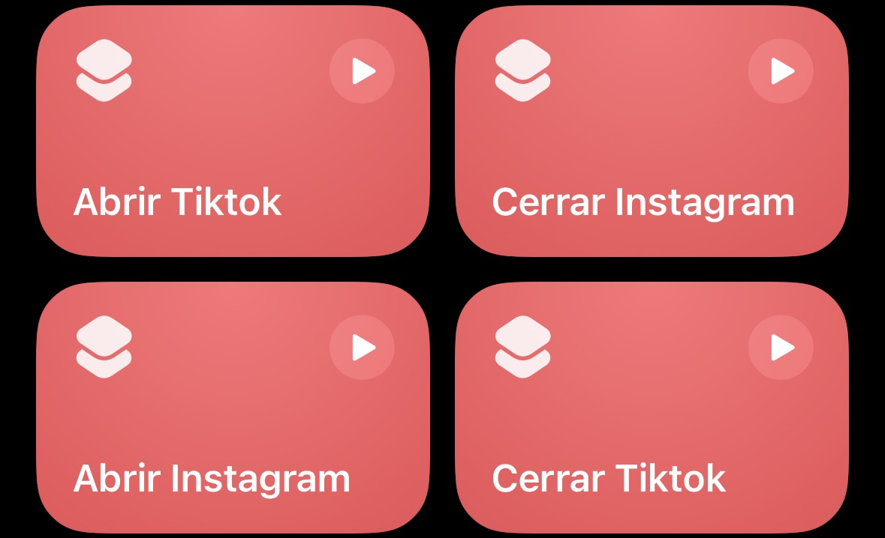
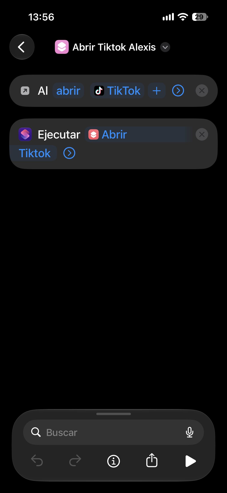
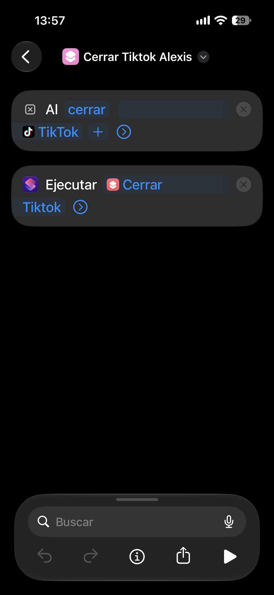
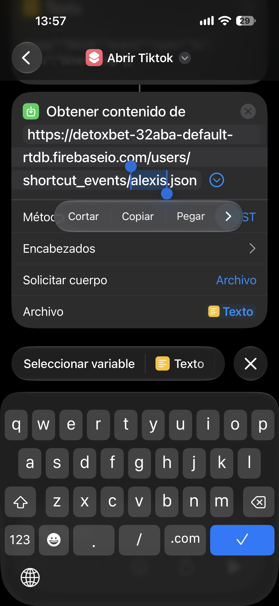

# DetoxBet — Social Accountability Screen-Time Challenge

**Team Members:**  
* Jorge Enrique Ruiz Liera  
* José Carlos Béjar Gómez  
* Alexis Vargas Moreno  

**Project Track:** Custom Project (**Guided Mode is NOT used**)  

### Quick Project Links
* **Live Web Application (Render):** [https://detoxbet.onrender.com/](https://detoxbet.onrender.com/)
* **Interactive Figma Prototype:** [View Figma Prototype](https://www.figma.com/proto/tFNzWftkr6Y9P3w3IUE0qh/HCI_FinalProject?node-id=2-2&t=Pxz0hZDHfV9rA6Jk-1)
* **Commercial Video ($\le$ 2 min):** [Commercial](https://drive.google.com/drive/folders/1TTMye28UmGv2lhOkaLbfrGeStCjbt4pa)

---

## 1. Problem, Target Audience & Social Value

### The Problem
University students and young adults experience high rates of impulsive *doomscrolling* on short-form video platforms such as **TikTok** and **Instagram Reels**, negatively affecting sleep quality, academic focus, and mental well-being. Traditional screen-time blockers rely on coercive lockouts or time-limit pop-ups that fail in practice because users experience frustration and easily bypass or disable them.

### Target Audience
Groups of friends (university students and young adults using iOS devices) who want to reduce their distracting screen time through shared, low-friction social accountability rather than solitary self-restriction.

### Proposed Solution & Scope
**DetoxBet** is a multiplayer web and mobile application built in Unity that turns digital detoxing into a competitive group challenge over a customizable duration:
* **Customizable Group Rooms:** A host creates a private room, selects a challenge duration, toggles the target distracting apps, and chooses a harmless, pre-determined social forfeit for the loser (e.g., *Pay for dinner*, *Post an embarrassing TikTok*, *Buy coffee*, *Wear a chosen outfit*, or *Sing karaoke*).
* **Realistic Demo Scope:** For our functional prototype, tracking is scoped to **two specific distracting apps (TikTok and Instagram)** rather than the entire iOS app ecosystem.
* **Zero-Friction Automated Telemetry:** Instead of requiring manual time logging, DetoxBet connects iOS native **Shortcuts** to a cloud backend so app usage is measured automatically in the background and reflected on a shared live leaderboard. At the end of the challenge, the participant with the **lowest** distracted time wins, and the participant with the **highest** distracted time must complete the selected challenge.

---

## 2. System Architecture

DetoxBet separates presentation, application services, cloud persistence, and OS-level telemetry:

* **Frontend (`Unity 6000.6.3f1` — WebGL & UI Toolkit):** Built with UXML/USS responsive layouts (`ScreenManager.cs` adapts automatically for mobile viewports below `900px`) and C# screen controllers (`Login`, `Menu`, `CreateRoom`, `JoinRoom`, `Room`, `Final`). Deployed publicly on Render at `https://detoxbet.onrender.com/`.
* **Backend (`Firebase Realtime Database` & `Firebase Auth`):** Communicates via REST API (`UnityWebRequest` + `Newtonsoft.Json`) to manage authentication (Anonymous, Username/Password, and Google Sign-In on WebGL), server clock synchronization (`SyncClockAsync`), room states, and real-time leaderboards (polled every `1.5s` by `RoomController.cs`).
* **iOS Telemetry Bridge (`iOS Shortcuts`):** Personal Automations on each participant's iPhone silently send `POST` webhooks with server timestamps (`{".sv": "timestamp"}`) whenever TikTok or Instagram is opened or closed. `ShortcutService.cs` pairs `open` and `close` events to compute exact distracted durations.

---

## 3. How to Run & Evaluate DetoxBet

### Option A: Live Demo Evaluation (Recommended — No Local Build Required)
1. **Open the App:** Navigate to [https://detoxbet.onrender.com/](https://detoxbet.onrender.com/) on an iPhone (Safari) or desktop browser.
2. **Create an Account:** Enter a unique username (and optional password or Google Sign-In on WebGL) on the **Login** screen.
3. **Configure iOS Tracking (One-Time Setup on Test iPhones):** Follow the steps in **Section 4** below to link your iPhone's Shortcuts to your username token.
4. **Create or Join a Room:**
   * **Host:** Tap **Create Room**, select duration, toggle **TikTok** and/or **Instagram**, pick a punishment, and share the generated **4-character room code**.
   * **Guest:** Tap **Join Room**, enter the 4-character code, and join the session. *(Note: Each account is locked to one active room per session to prevent mid-challenge abandonment).*
5. **Test Real-Time Tracking:** Once the host starts the challenge, open and close **TikTok** or **Instagram** on a configured iPhone. Within seconds, `ShortcutService` processes the `open`/`close` timestamps and updates the **Room** leaderboard across all connected devices.
6. **View Final Verdict:** When the timer expires (or when the host triggers the fast-forward/finish option during testing), all participants transition to the **Final** screen displaying the Winner, Loser, and assigned punishment.

### Option B: Running Locally in Unity Editor
1. Clone this repository:
   ```bash
   git clone [https://github.com/AlexisVarBB/HCI_FinalProject.git](https://github.com/AlexisVarBB/HCI_FinalProject.git)
   ```
2. Open **Unity Hub**, click **Add project from disk**, and select the `HCI_FinalProject` folder.
3. Launch the project using **Unity `6000.6.3f1`** and wait for package resolution (`Input System`, `Newtonsoft JSON`, `URP`, `Unity UI`).
4. Open `Assets/Scenes/SampleScene.unity` and press **Play** in the Editor to test UI navigation and Firebase REST synchronization.
5. *(Optional WebGL Build)*: Go to **File $\rightarrow$ Build Profiles**, select `Assets/Settings/Build Profiles/Web.asset`, ensure the custom `DetoxBet` WebGL template (`Assets/WebGLTemplates/DetoxBet/index.html`) is selected in Player Settings, and click **Build**.

---

## 4. iOS Shortcuts Configuration Guide (Time Tracking)

DetoxBet runs in the browser at [detoxbet.onrender.com](https://detoxbet.onrender.com/), while iOS usage tracking requires a one-time setup in the iPhone **Shortcuts (Atajos)** app.

### Requirements
* **Internet connection:** Both the web app and the tracking shortcuts send data to Firebase.
* **iPhone (iOS):** Only iOS can automatically report when Instagram and TikTok are opened or closed via Personal Automations.
* **One room per session:** Once you enter a room, you remain in it for the entire challenge.

### Step 1: Install the 4 Shortcuts
Open each link below on your iPhone and tap **Add Shortcut**:

| Target App | Open Event Shortcut | Close Event Shortcut |
| :--- | :--- | :--- |
| **Instagram** | [Install Abrir Instagram](https://www.icloud.com/shortcuts/af1b46c41b3d4ab28322bcce03e31839) | [Install Cerrar Instagram](https://www.icloud.com/shortcuts/2ab90083b62a4929b3e1aab0660ddc57) |
| **TikTok** | [Install Abrir Tiktok](https://www.icloud.com/shortcuts/62eb409b54e54d8f8e158b8886a341dd) | [Install Cerrar Tiktok](https://www.icloud.com/shortcuts/e72e9e4ee6394db4a4091977dd5a51eb) |

### Step 2: Set Your User Token in All 4 Shortcuts
Your **token** is your DetoxBet username in **all lowercase, without spaces or accents** (e.g., `Ana López` $\rightarrow$ `analopez`).
1. Open each of the 4 shortcuts in edit mode.
2. Do **not** edit the **Text** block (`{"app":"tiktok","event":"open","ts":{".sv":"timestamp"}}`).
3. In the **Get Contents of URL** (*Obtener contenido de*) block, replace the ending username with your own token:
   ```text
   [https://detoxbet-32aba-default-rtdb.firebaseio.com/users/shortcut_events/](https://detoxbet-32aba-default-rtdb.firebaseio.com/users/shortcut_events/)<YOUR_TOKEN>.json
   ```

### Step 3: Create the 4 Personal Automations
Create four automations in **Shortcuts $\rightarrow$ Automation $\rightarrow$ + $\rightarrow$ App** linking each app event to its corresponding shortcut:

| Target App | Trigger Condition | Automation Setting | Shortcut Executed |
| :--- | :--- | :--- | :--- |
| **Instagram** | *Is Opened* (*Se abra*) | **Run Immediately** (*Notify When Run*: OFF) | `Abrir Instagram` |
| **Instagram** | *Is Closed* (*Se cierre*) | **Run Immediately** (*Notify When Run*: OFF) | `Cerrar Instagram` |
| **TikTok** | *Is Opened* (*Se abra*) | **Run Immediately** (*Notify When Run*: OFF) | `Abrir Tiktok` |
| **TikTok** | *Is Closed* (*Se cierre*) | **Run Immediately** (*Notify When Run*: OFF) | `Cerrar Tiktok` |

> **Important:** **Run Immediately** (*Ejecutar de inmediato*) must be enabled on all four automations; otherwise, iOS will ask for manual confirmation and the event will not be sent.

### Visual Step-by-Step Reference (iOS Shortcuts)

| 1. Installed Shortcuts Library | 2. Trigger: Is Opened (Run Immediately) | 3. Trigger: Is Closed | 4. Replacing User Token in URL |
| :---: | :---: | :---: | :---: |
|  |  |  |  |

---

## 5. Repository & Documentation Structure

```text
HCI_FinalProject/
├── Assets/
│   ├── Scenes/SampleScene.unity          # Main single-scene application entry point
│   ├── Scripts/
│   │   ├── ScreenManager.cs              # Central UI Toolkit state & responsive layout manager
│   │   └── Services/                     # Firebase REST, Auth, Room, and ShortcutServices
│   ├── UI/Screens/                       # UXML/USS & Controllers (Login, Menu, CreateRoom, JoinRoom, Room, Final)
│   ├── Plugins/WebGL/                    # JS bridges for Google Auth and browser visibility
│   └── WebGLTemplates/DetoxBet/          # Custom WebGL HTML template with Firebase JS SDK
├── docs/
│   ├── DesignJustification.md            # HCI principles, human factors, and platform interaction
│   ├── UserResearch.md                   # Target user research findings & Customer Journey Map
│   ├── UserTesting.md                    # Usability testing protocol, metrics, and iterations
│   ├── AIUsage.md                        # AI tools disclosure and verification (AI Level 1)
│   └── images/                           # Screenshots and visual evidence for documentation
└── README.md                             # Project overview, scope, and setup instructions
```
