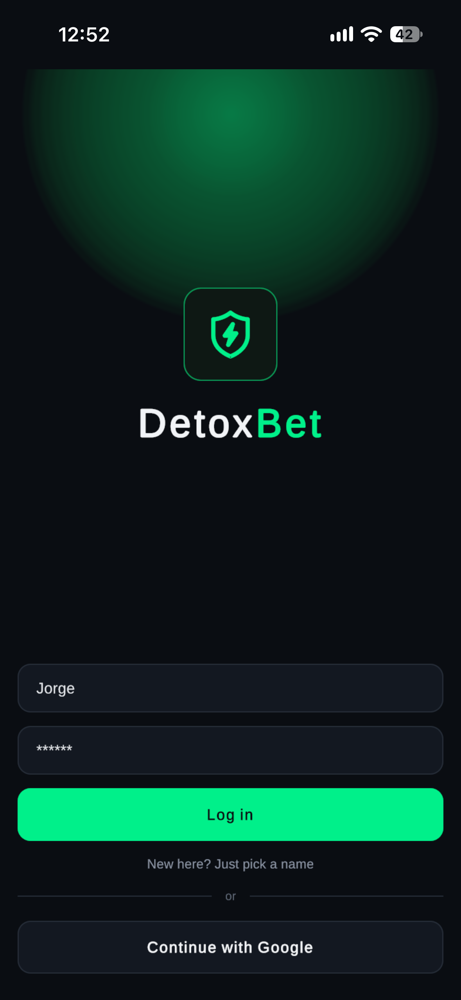
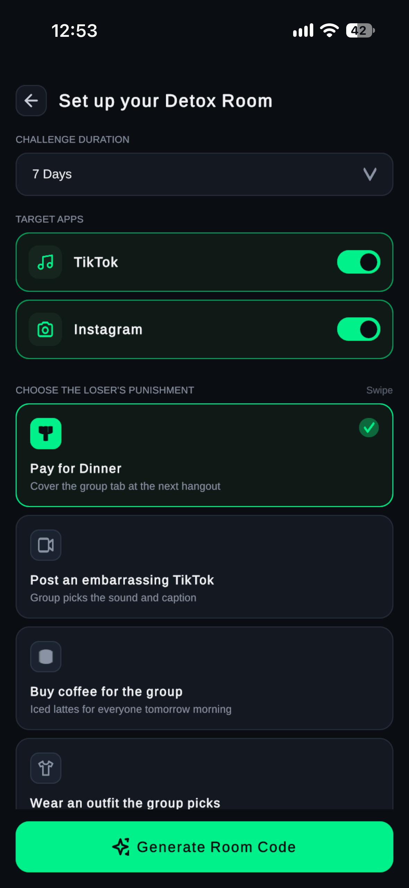
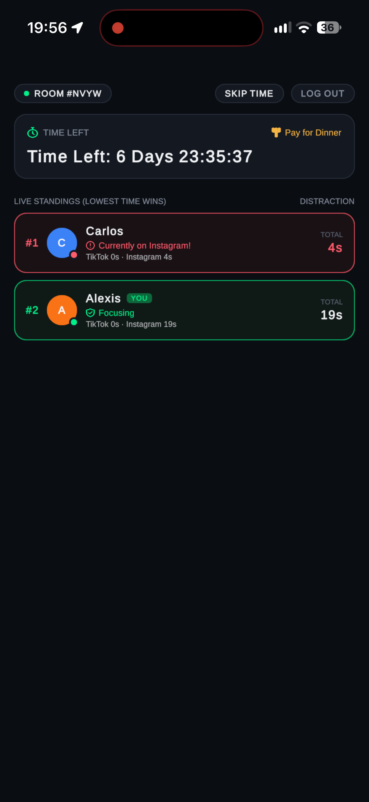
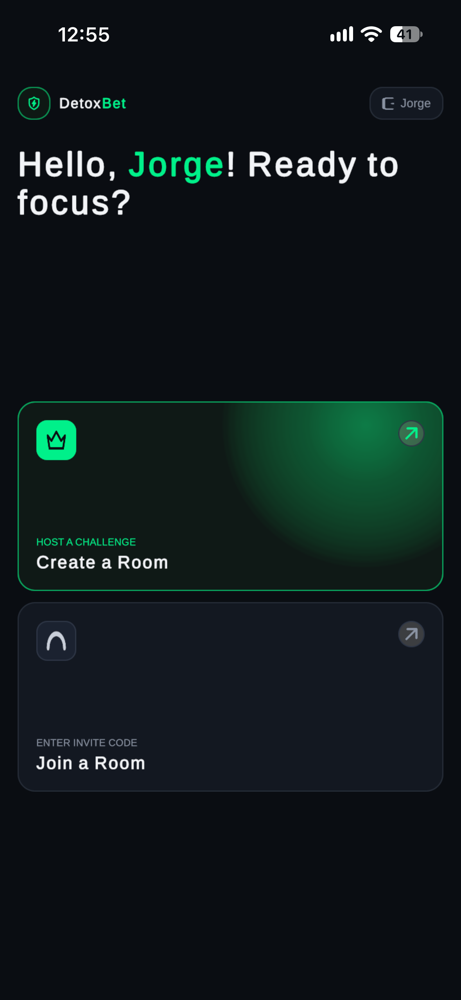
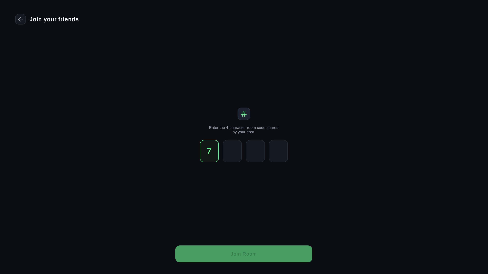
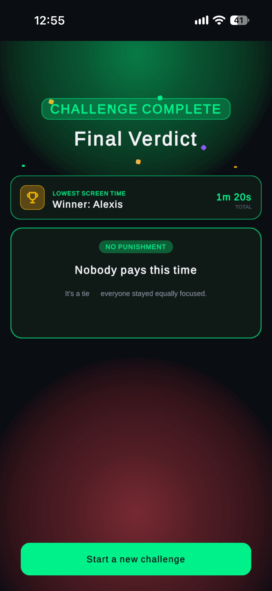
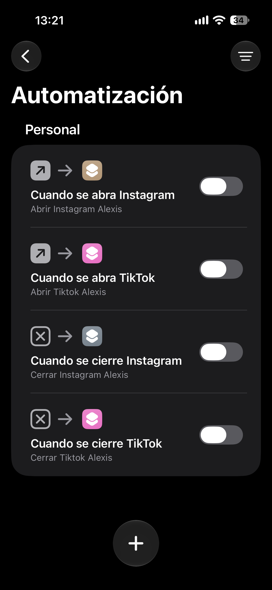
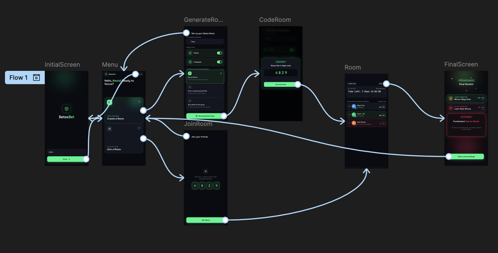
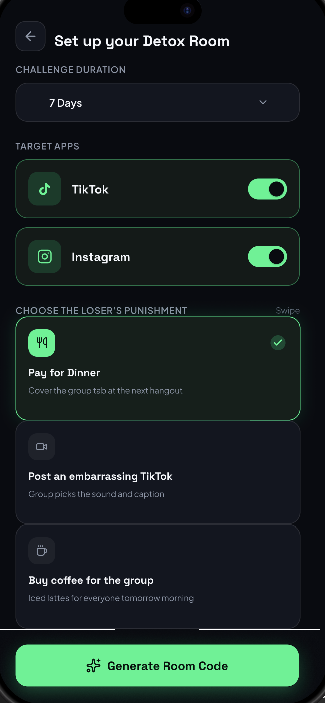
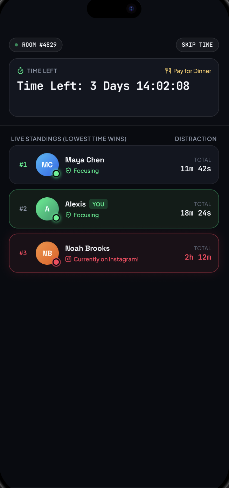

# Design Justification — DetoxBet

**Platform:** iOS (Unity `6000.6.3f1` WebGL Frontend + Firebase Realtime Database REST API + Native iOS Shortcuts)  

---

## 1. Interaction Architecture & Application Flow

The interaction architecture of **DetoxBet** guides groups of friends through an end-to-end social accountability loop with minimal friction. Implemented in **Unity (`6000.6.3f1`)** using **Unity UI Toolkit (UXML/USS)** within a single-scene state architecture (`SampleScene.unity` managed by `ScreenManager.cs`), the application transitions across six core navigation states and two branching user paths (**Host Path** vs. **Guest Path**):

$$\text{Login} \rightarrow \text{Menu} \rightarrow (\text{CreateRoom} \lor \text{JoinRoom}) \rightarrow \text{Room} \rightarrow \text{Final} \rightarrow \text{Menu}$$

### Final Rendered Screens, States & Error Handling

1. **Screen 1 — `Login` (`render-screen1-login.png`):**
   * **Purpose:** Establishes user identity via username/password authentication, anonymous sign-in with account protection, or Google Sign-In on WebGL (`FirebaseLoginService.cs`).
   * **Validation & Error Conditions:** `Username.cs` normalizes display names into unique lowercase alphanumeric tokens (`usernames/{key}`) to prevent duplicate identities and displays inline validation feedback if a username is already taken or credentials are invalid.
2. **Screen 2 — `Menu` (`render-screen2-menu.png`):**
   * **Purpose:** Presents two primary, equally weighted navigation paths: **Create Room** (Host Path) and **Join Room** (Guest Path), alongside persistent session recovery (`current_room`).
3. **Screen 3A — `CreateRoom` / Host Configuration (`render-screen3a-createroom.png`):**
   * **Purpose:** Controlled by `CreateRoomController.cs`, allowing the host to configure a customizable challenge duration, toggle target distracting apps (**TikTok** and/or **Instagram**), and select a pre-determined punishment for the loser.
   * **Feedback:** Generating the room produces a unique 4-character alphanumeric room code and initializes the room in the `waiting` / `active` state on Firebase.
4. **Screen 3B — `JoinRoom` / Guest Entry & Error Prevention (`render-screen3b-joinroom-states.png`):**
   * **Purpose:** Controlled by `JoinRoomController.cs`, enabling participants to join an active group challenge using the 4-character room code.
   * **Error Conditions & States:** Enforces 4-character code formatting before submission and handles non-existent or invalid room codes with clear inline error feedback without losing the user's authenticated session.
5. **Screen 4 — `Room` / Active Leaderboard (`render-screen4-room-leaderboard.png`):**
   * **Purpose:** Controlled by `RoomController.cs`, polling Firebase every `1.5 seconds` to display a live ranking sorted from lowest distraction time (winning) to highest distraction time (losing), paired with a synchronized countdown timer (`FirebaseRest.SyncClockAsync`).
   * **Real-Time States:** Differentiates passive focus from live distraction using event-driven telemetry (`open` vs. `close` app events) processed by `ShortcutService.cs`.
6. **Screen 5 — `Final` / Resolution & Verdict (`render-screen5-final-verdict.png`):**
   * **Purpose:** Controlled by `FinalController.cs`, triggered automatically when the synchronized room timer ends (transitions room status to `finished`). Displays the **Winner** (lowest accumulated distraction time), the **Loser** (highest accumulated time), and the locked-in social forfeit.

| Login & Menu | Create Room & Join Validation | Live Room & Final Verdict |
| :---: | :---: | :---: |
|  |  |  |
|  |  |  |

---

## 2. HCI Principles & Human Factors

Our design decisions are directly grounded in the human factors and interaction principles studied during the course:

### 2.1 User Psychology: "Let the User Feel in Control but Safe" & "Never Blame the User"
* **Course Concept (Session 08 — User Psychology):** Effective interactive systems balance user autonomy with structural guardrails—letting users feel in control of their actions while keeping them safe from destructive outcomes, and never blaming the user when an interaction fails.
* **Application in DetoxBet:** Traditional screen-time blockers rely on coercive lockouts. Psychologically, forced restriction triggers frustration and reactance, causing users to disable the blocker or abandon the tool. DetoxBet keeps the user **in control**—they are never locked out of TikTok or Instagram—while replacing coercion with **asynchronous social accountability** and loss aversion (avoiding a lighthearted social forfeit among friends). Furthermore, `ShortcutService.cs` gracefully handles duplicate `open` events or unmatched `close` timestamps without penalizing or blaming the user for network delays.

### 2.2 Human Perception: Foveal vs. Peripheral Vision & Color Contrast
* **Course Concept (Session 08 — Human Perception & Session 11 — Interaction Speeds):** Human vision separates high-acuity central processing (**foveal vision**) from motion- and contrast-sensitive **peripheral vision**, with visual reaction times averaging `0.15s–0.25s`.
* **Application in DetoxBet:** On the active **`Room` Leaderboard**, users should not need to read every row carefully to understand group standing. We paired a high-contrast dark interface with semantic color accents and `1.5s` live polling updates (`RoomController.cs`) so rank changes and active distraction states immediately draw peripheral attention and act as an instant social nudge.

### 2.3 Cognition & Interaction Styles: Recognition Over Recall & Zero-UI Automation
* **Course Concept (Session 03 — Interaction Styles: Menu Selection & Session 11 — Interaction Speeds):** In *Menu Selection* interfaces, the system displays available options so that **users recognize instead of remembering**, reducing cognitive load. Additionally, manual text composition is slow (`~19 WPM`) and error-prone compared to visual selection.
* **Application in DetoxBet:**
  1. **Zero-UI Event Telemetry:** Requiring users to manually log daily social media minutes introduces severe friction and estimation error. By automating tracking in the background via native iOS Shortcuts (`open`/`close` event webhooks), data capture requires zero manual effort during the challenge.
  2. **Structured Controls:** `CreateRoom` replaces free-text forms with selectable duration presets, binary toggles for TikTok and Instagram, and a pre-defined list of challenges so hosts configure rooms through recognition rather than recall.

### 2.4 Constraints, Error Prevention & Cost of Error
* **Course Concept (Session 08 — Physical/Logical Constraints & Session 03 — The Cost of Error):** Just as physical shape-sorters prevent invalid insertions, logical interface constraints prevent invalid states before they happen, minimizing the **cost of error**.
* **Application in DetoxBet:**
  * **Pre-Determined Challenge Catalog:** Allowing free-text punishments could lead to impossible, unsafe, or non-consensual bets (high social cost of error). Restricting selection to a curated set of safe, lighthearted forfeits (*Pay for dinner*, *Post an embarrassing TikTok*, *Buy coffee*, *Wear a chosen outfit*, *Sing karaoke*) guarantees every bet is achievable.
  * **One-Room Commitment Constraint:** Once a user enters a room (`current_room`), the system locks them to that active room for the duration of the challenge, preventing users from abandoning a group mid-session when they are losing.
  * **Input Validation & Normalization:** `Username.cs` automatically sanitizes user tokens (stripping spaces, accents, and uppercase characters) to prevent malformed Firebase REST paths, while `JoinRoomController.cs` enforces valid 4-character room codes.

### 2.5 Consistency, System Feedback & Mental Models
* **Course Concept (Session 08 — User Psychology: Feels, Wants, Thinks, Believes, Remembers):** Users rely on spatial memory (*Remembers*) when interacting with repeated controls; inconsistent button placement (such as swapping `OK` and `Cancel` positions) causes avoidable execution slips.
* **Application in DetoxBet:** Shared UI components (`AccountDialog.cs`, `RadialGlow.cs`, `ShieldBoltIcon.cs`) and unified UXML/USS style sheets keep primary actions consistently anchored in the lower thumb zone across every screen. Additionally, `FirebaseRest.SyncClockAsync` synchronizes device clocks against Firebase server timestamps (`ServerNowMs`) so all participants share an exact, consistent countdown regardless of local phone clock drift.

---

## 3. Platform-Specific Interaction (iOS)

DetoxBet is engineered around the hardware ergonomics, software constraints, and real-world usage context of **iOS (iPhone)**:

* **Hybrid iOS WebGL + Native Shortcuts Ecosystem Integration:** Because Apple restricts third-party access to the `Screen Time API` without paid enterprise entitlements, DetoxBet combines a browser-accessible WebGL client (`https://detoxbet.onrender.com/`) with iOS's native **Shortcuts (Personal Automations)** engine—requiring **no Guided Mode** and **no paid developer certificates**.
  * Four lightweight shortcuts (`Abrir Instagram`, `Cerrar Instagram`, `Abrir Tiktok`, `Cerrar Tiktok`) are triggered automatically in the background (*Run Immediately* enabled, *Notify When Run* disabled) whenever the user opens or closes TikTok or Instagram.
  * Each shortcut sends a silent `POST` request with a server timestamp (`{"app":"tiktok","event":"open","ts":{".sv":"timestamp"}}`) to `.../users/shortcut_events/{token}.json`, allowing `ShortcutService.cs` to reconstruct exact usage intervals even when the browser tab is suspended.

  

*Figure 1: Native iOS Personal Automations configured with "Run Immediately" to silently report TikTok and Instagram open/close events to Firebase.*

* **Touch & Gesture Modality (Session 03 — Modality / Gesture & Direct Manipulation):** `ScreenManager.cs` detects mobile viewports (applying responsive layout rules below the `900px` desktop breakpoint) to optimize the UI for vertical (`portrait`) single-handed iPhone interaction. Interactive toggles, lists, and buttons are sized for comfortable thumb reach and provide immediate visual state feedback so the system clearly communicates what it recognized.
* **Context of Use, Comfort & Accessibility (Session 11 — Context of Use):** University students check their phones across shifting environments, from dimly lit bedrooms at night to bright outdoor campus walkways under direct sunlight.
  * **Visual Comfort:** A dark-mode default palette reduces eye strain and screen glare during evening usage.
  * **Outdoor Legibility & Contrast:** High-luminance typography paired with saturated accent indicators maintains legibility even under direct sunlight.
  * **Motor Accessibility:** Generous padding around interactive cards and primary buttons prevents accidental taps when users are walking or distracted.

---

## 4. Interaction Blueprint & Visual Evolution (Figma Draft vs. Final Render)

Figma served as our initial structural wireframe and interactive flow prototype to validate navigation paths, state transitions, and error handling before implementing the final UXML/USS interface deployed on Render.

*Figure 2: Complete end-to-end interaction flow and state connections mapped in the initial Figma prototype.*

| Screen / Feature | Initial Figma Draft | Final Rendered Application | Consistency & Iteration Notes |
| :--- | :---: | :---: | :--- |
| **Room Setup (`CreateRoom`)** |  |  | Preserved the 3-part configuration hierarchy (Duration, Target Apps, Punishment Selection) while refining responsive UXML/USS layout spacing and visual contrast in the final render. |
| **Live Leaderboard (`Room`)** |  |  | Maintained rank ordering (lowest to highest distracted time) and real-time status clarity, upgrading live countdown synchronization (`SyncClockAsync`) and event-based time calculation. |
