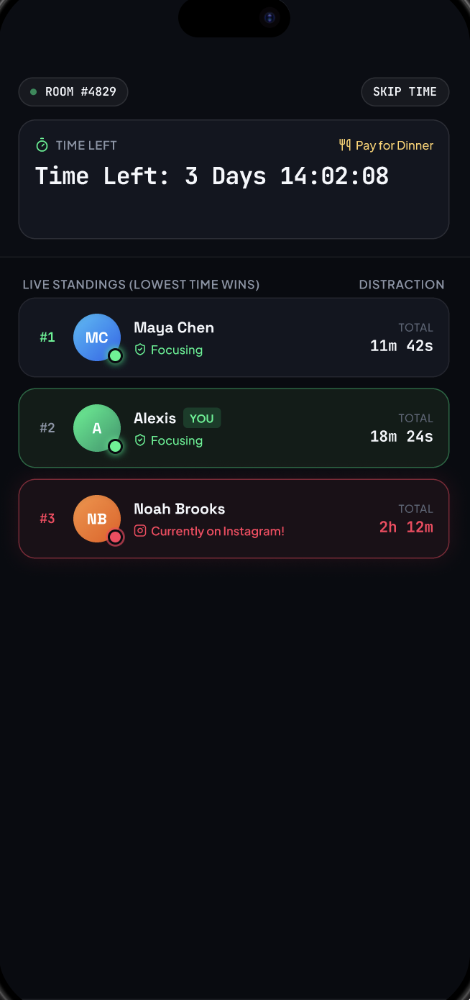

# User Testing & Iteration Report — DetoxBet

**Team Members:** Jorge Enrique Ruiz Liera, José Carlos Béjar Gómez, Alexis Vargas Moreno  
**Environment Tested:** Continuous live WebGL deployment on Render (`https://detoxbet.onrender.com/`). *(Note: Because updates were deployed continuously by overwriting the same Render instance, earlier iterations are no longer hosted separately; "Round 1" reflects testing prior to our UI/logic updates and "Round 2" reflects retesting on the current live build.)*

---

## 1. Testing Protocol & Participant Profile

* **Target Audience:** 4 university students (ages 19–23, daily iPhone users who use TikTok and Instagram).
* **Methodology:** Moderated task-based usability testing using the *Think-Aloud* protocol. Participants tested the live WebGL build on their own iPhones (Safari) after completing the one-time iOS Shortcuts setup.
* **Core Evaluation Tasks:**
  * **Task 1 (Host Flow):** Create a new room, set a custom challenge duration, select target apps (TikTok & Instagram), pick a punishment, and generate the 4-character room code.
  * **Task 2 (Guest Flow):** Join an active room using a 4-character code.
  * **Task 3 (Live Tracking & Comprehension):** Switch to TikTok/Instagram briefly, return to DetoxBet, and identify on the leaderboard who is losing and which app caused the distraction time.
  * **Task 4 (Session Recovery):** Close/refresh the browser tab mid-challenge and return to the active room.

---

## 2. Functional Test Cases (Current Live Build)

| # | Case | Setup | Steps | Expected | Actual | Pass/Fail |
| :---: | :--- | :--- | :--- | :--- | :--- | :---: |
| 1 | **Account & Token Normalization** | Fresh browser session | Enter username with spaces/uppercase (e.g., `Ana Lopez`) and log in | Account created; normalized token (`analopez`) stored for Shortcuts | As expected | **Pass** |
| 2 | **Room Creation (Custom Time)** | Logged in as Host | Select custom duration, toggle TikTok & Instagram, pick punishment, confirm | 4-character code generated; room initialized in Firebase | As expected | **Pass** |
| 3 | **Invalid Room Code** | Logged in as Guest | Enter non-existent 4-character code (`ZZZZ`) in `JoinRoom` | Inline error message shown; user stays on `JoinRoom` | As expected | **Pass** |
| 4 | **Live Shortcut Telemetry** | Active room + Shortcuts ON | Open TikTok for ~10s, close it, return to DetoxBet | `ShortcutService` pairs `open`/`close` events; leaderboard updates within 1.5s | As expected | **Pass** |
| 5 | **Session Persistence** | Active room | Close Safari tab and reopen `detoxbet.onrender.com` | User automatically returns to their active `Room` | As expected | **Pass** |
| 6 | **Final Verdict Transition** | Active room timer reaches `00:00` | Wait for countdown to finish | All clients transition to `Final` screen showing Winner, Loser, and forfeit | As expected | **Pass** |

---

## 3. Usability Testing Results

### Task Completion, Efficiency & Observations

| Participant | Round | Task | Completed | Time | Errors | Help Needed | Observations & Direct Comments |
| :--- | :---: | :---: | :---: | :---: | :---: | :---: | :--- |
| **P1** | Round 1 | T1 (Host) | Yes | 42s | 0 | None | "I wish I could pick a shorter custom time just for a 30-minute study sprint." |
| **P1** | Round 1 | T4 (Recovery) | **No** | 25s | 1 | Yes | Refreshed Safari after checking TikTok and got kicked back to `Menu`. Could not find how to re-enter the active room. |
| **P2** | Round 1 | T2 (Guest) | Yes | 19s | 1 | None | Mistyped the 4-character code once; understood the inline error and joined on the second try. |
| **P2** | Round 1 | T3 (Leaderboard) | Yes | 28s | 0 | None | Saw their total time increase, but asked: "Is this from Instagram or TikTok? I can't tell which one got me." |
| **P3** | Round 1 | T1 (Host) | Yes | 35s | 1 | Yes | Entered/started the room immediately after creating the code before P2 joined, blocking P2 from entering. |
| **P3** | Round 1 | T3 (Leaderboard) | Yes | 22s | 0 | None | Immediately noticed rank changes during live polling. |
| **P4** | Round 2 (Retest) | T1 (Host) | Yes | 29s | 0 | None | Easily configured a custom duration. |
| **P4** | Round 2 (Retest) | T3 & T4 | Yes | 18s | 0 | None | Immediately identified separate TikTok vs. Instagram times; refreshed Safari and returned directly to the active room without help. |

### Summary Metrics (Satisfaction)
* **Satisfaction (Qualitative Feedback):** Participants rated the social forfeit mechanic as much more motivating than native iOS limits (*"Seeing my time go up in front of my friends actually made me close TikTok right away"*).

---

## 4. Iterations Implemented (Evidence-Driven Changes)

Based on observations from Round 1, the team implemented three major improvements before Round 2 retesting:

1. **Session Persistence (`current_room` Recovery):**
   * *Evidence:* P1 was kicked back to the `Menu` screen after Safari suspended/reloaded the WebGL tab while switching apps.
   * *Fix:* Implemented persistent room state recovery so users who close or refresh the browser are automatically routed back to their active `Room`.
2. **Per-App Time Breakdown (A/B Comparison — Global vs. Split View):**
   * *Evidence:* In the initial design (Version A — Global Timer only), P2 could not tell whether their accumulated penalty time came from Instagram or TikTok.
   * *Fix:* Upgraded the `Room` leaderboard to **Version B (Per-App Breakdown)**, displaying individual time counters for **TikTok** and **Instagram** alongside total standing. In Round 2 retesting, P4 identified their primary distraction source immediately with zero hesitation.
3. **Customizable Challenge Duration:**
   * *Evidence:* P1 noted that fixed durations did not fit flexible university schedules (e.g., short study blocks vs. full-evening hangouts).
   * *Fix:* Added a customizable duration selector in `CreateRoomController.cs` so hosts can tailor the exact length of each session.

| Before (Version A: Global Time Only — Initial Design) | After (Version B: Per-App Breakdown & Custom Time — Live Build) |
| :---: | :---: |
|  |  |

---

## 5. Known Limitations & Unresolved Issues

During testing, we identified two structural limitations that remain open for future iterations:

* **Host Entry / Late-Joiner Lockout:** Once the host creates a room code and enters/starts the active room, additional guests can no longer join with that code. Currently, the host must share the code, wait for all participants to join, and then enter/start the session. *Planned fix:* Add an explicit waiting lobby state (`waiting` $\rightarrow$ `active`) with a live participant counter before the host taps "Start Challenge."
* **iOS Shortcuts Trust & Configuration Dependency:** DetoxBet relies on each participant properly configuring and keeping their 4 iOS Personal Automations enabled (*Run Immediately*). If a user misconfigures their `{token}` or manually disables an automation mid-challenge, Firebase receives no `open`/`close` events and the leaderboard displays `0s` of distraction. *Planned fix:* Add a pre-challenge "Ping Test" button in the lobby to verify each player's shortcut webhook before starting.